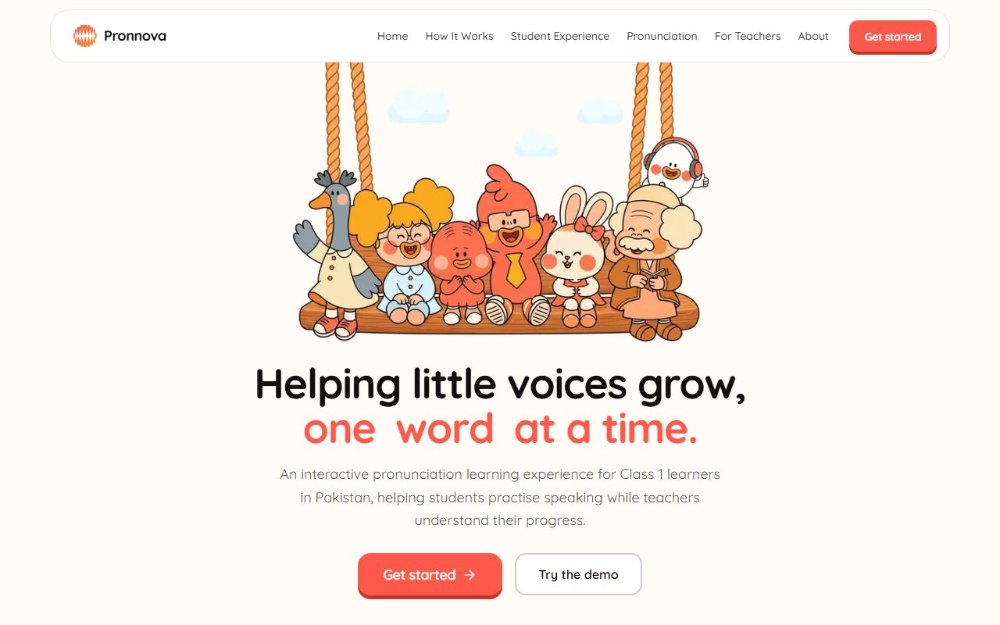
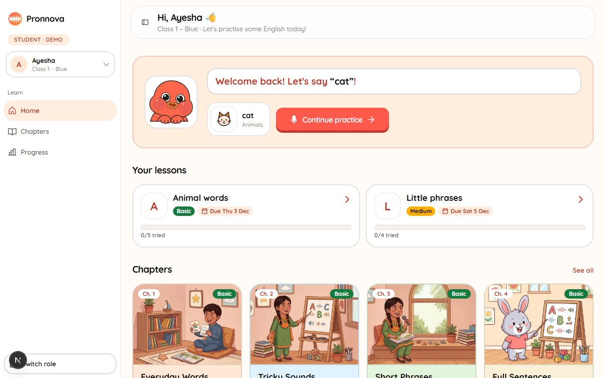
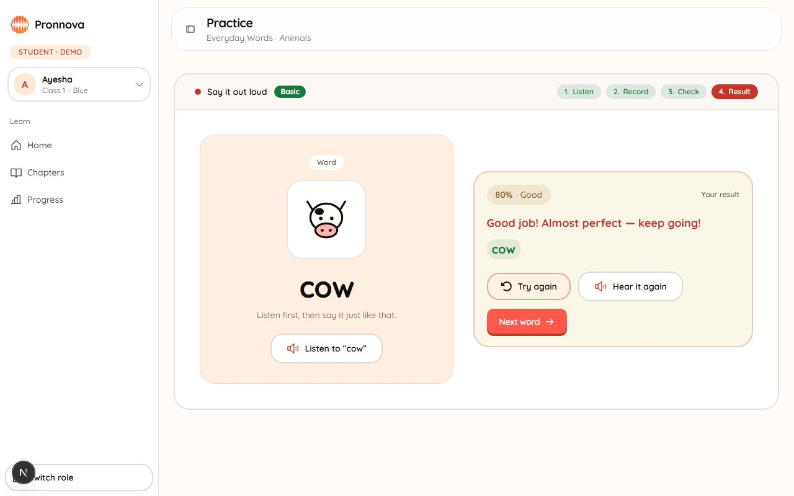

# Pronnova

Pronnova helps young learners practise speaking English clearly. Children listen to a word or sentence, say it out loud, and get instant, friendly feedback. Teachers set the lessons and follow each child's progress.

Built for Class 1 students and their teachers.

## For students

1. Choose your name from your class list. No password needed.
2. Open a lesson your teacher gave you, or pick a chapter.
3. Tap Listen to hear the word, then record yourself saying it.
4. See your score and a short tip. Try again or move to the next word.

| Your home page | Practice and feedback |
| --- | --- |
|  |  |

## For teachers

1. Create your classes and add your students.
2. Make a lesson: type the words, paste a list, or upload a Word file. Pronnova checks that each item suits the level you chose (Basic, Medium or Advanced).
3. Assign the lesson to the whole class or to selected students, with a due date.
4. Follow each student's attempts and progress from your dashboard.

| Your lessons | Making a lesson |
| --- | --- |
|  |  |

## Feedback

Every attempt gets a score from 0 to 100 and a simple label:

| Score | Label |
| --- | --- |
| 85 and above | Excellent |
| 70 to 84 | Good |
| Below 70 | Average |

Each result comes with one clear tip for the next try, and students can replay the correct pronunciation as often as they like.

## Privacy

Recordings are stored privately and are only used to give feedback and show progress to the student's teacher.

## Running Pronnova

Setup instructions are in the [team guide](docs/team-guide.md).
