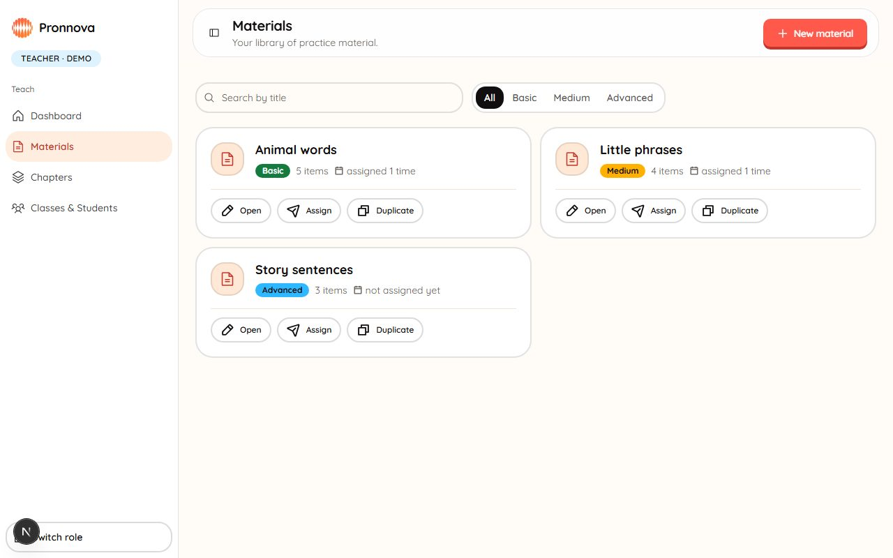
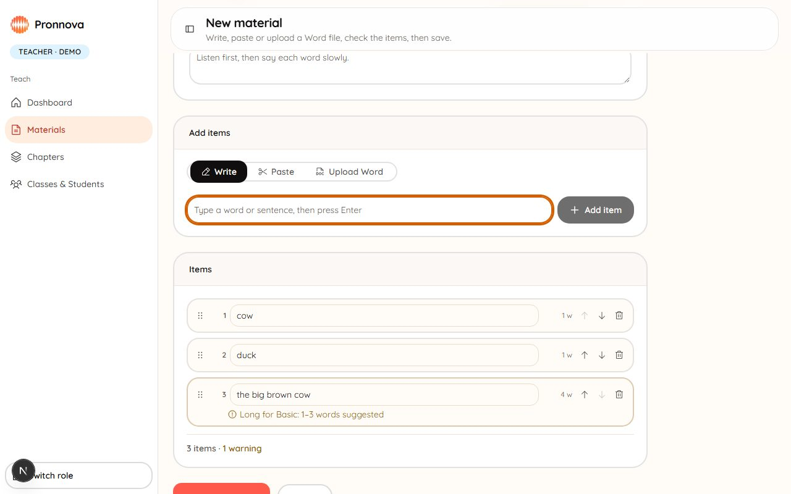

# Pronnova

English pronunciation practice and assessment for Class 1 students in Pakistan, with a teacher dashboard for classes, lessons and assignments.

Final Year Project (FYP-1), FAST-NU Chiniot.


## How it works

**Student**

1. Pick your name from the class list (no password, a teacher-managed roster).
2. Open an assigned lesson or a chapter.
3. Listen to the word or sentence, then record your own voice.
4. Get a score (0–100) with a short tip, then try again or move to the next item.

| Student home | Practice and feedback |
| --- | --- |
|  |  |

**Teacher**

1. Create classes and add students.
2. Create a lesson: type items, paste a list, or upload a Word file. Items are split and checked for the chosen level (Basic, Medium, Advanced).
3. Assign the lesson to a whole class or selected students, with a due date.
4. Review attempts and progress on the dashboard.

| Materials library | Material editor |
| --- | --- |
|  |  |

**Under the hood**

The browser records audio and sends it to a server route. The server stores the recording in a private Supabase bucket, scores it with the configured speech engine, and saves the attempt. All database and storage access runs on the server with the secret key; the browser never talks to Supabase directly.

## Tech stack

Next.js 16 (App Router), React 19, TypeScript, Tailwind CSS v4, shadcn/ui with Animate UI and Motion, Supabase (Postgres and Storage), Vitest, Playwright.

## Getting started

Requirements: Node.js 20+ and a Supabase project.

```powershell
npm install
```

Create `.env.local` in the project root:

```
SUPABASE_URL=
SUPABASE_SECRET_KEY=
SUPABASE_DB_URL=
SPEECH_ENGINE=mock
```

`SPEECH_ENGINE` can be `mock`, `azure` (needs `AZURE_SPEECH_KEY`, `AZURE_SPEECH_REGION`) or `python` (needs `SPEECH_ENGINE_URL`).

Set up the database and start the app:

```powershell
npm run db:push
npm run db:seed
npm run dev
```

Open http://localhost:3000 and choose Student or Teacher.

## Scripts

| Command | Purpose |
| --- | --- |
| `npm run dev` | Development server |
| `npm run build` / `npm start` | Production build and server |
| `npm test` | Unit tests (Vitest) |
| `npm run test:db` | Database tests |
| `npm run test:e2e` | End-to-end tests (Playwright) |
| `npm run db:push` / `db:seed` / `db:status` | Apply migrations, load demo data, check status |

## Documentation

- [docs/index.md](docs/index.md): map of all documentation
- [docs/team-guide.md](docs/team-guide.md): structure, flows and local setup
- [docs/architecture.md](docs/architecture.md): system design
- [docs/database.md](docs/database.md): tables and functions
- [docs/qa-report.md](docs/qa-report.md) and [docs/demo-script.md](docs/demo-script.md): QA results and demo walkthrough
