# Pronnova — Software Requirements Specification

> Converted from `Pronnova_SRS_Updated_28_oct.docx` (approved proposal, revised 28 Oct 2026). The DOCX is the source of truth; this copy is for quick reading by people and AI agents. Diagrams are in `docs/srs/`. Do not edit requirements here — change the DOCX, then re-convert.

**Team:** Muhammad Fahad (23F-0696), Muhammad Usman (23F-0570), Muteeba Shahzad (23F-0627) · **Supervisor:** Dr. Tahir Farooq · Department of Computer Science, FAST-NUCES Chiniot, 2026

**FYP-1 scope** (ADR-002): UC-03, UC-04, UC-05, UC-06, UC-10 — no authentication. See `../specs/fyp1-scope.md`.

## Abstract

Pronnova is an AI-powered English pronunciation assessment and adaptive learning system designed to help students improve their pronunciation through guided speaking practice while enabling teachers to monitor their progress. Teachers can create classes, upload learning content, generate and assign exercises, and view individual and class-level performance.

Student complete exercises by pronouncing words, phrases, and sentences through a microphone. The system analyses student speech against expected reference content using speech recognition, alignment, and pronunciation assessment techniques to provide performance scores and identify problematic words or pronunciation difficulties.

A key feature of Pronnova is recurring error analysis. The system tracks student performance over multiple attempts, identifies repeated weaknesses, and recommends personalized practice. The project will also investigate suitable speech and pronunciation assessment technologies for Pakistani English learners.

Learning content will be organized according to curriculum level and exercise difficulty, while the teacher dashboard will provide insights into student progress and common classroom difficulties. Pronnova aims to combine automated pronunciation assessment, personalized learning, and teacher-supported classroom monitoring in a scalable learning environment.

## 1. Introduction

English is widely used in education and professional communication, yet many students struggle with pronunciation and accurate speaking. Teachers, especially in large classrooms, cannot always provide individual feedback, allowing pronunciation mistakes to continue unnoticed. AI and speech technologies can help provide immediate and personalized support.

Pronnova is an AI-powered pronunciation learning system that allows students to practice words, phrases, and sentences using a microphone. The system analyses student speech against expected reference content, provides feedback and performance scores, tracks recurring mistakes, and enables teachers to monitor student progress.

Unlike simple speech-to-text systems, Pronnova does not treat correct transcription as proof of correct pronunciation. It combines speech recognition with pronunciation assessment to provide more meaningful feedback.

## 2. Vision Document

### 2.1 Problem Statement

*Table 1: Problem Statement*

| Category | Description |
|---|---|
| Problem | Students can read and understand English but pronounce it incorrectly. Teachers lack the time to give each Student individual feedback, especially in large classes, and Students do not know which words or sounds they mispronounce. |
| Affects | Students learning English and the Teachers who monitor their progress. |
| Impact | Students repeat the same mistakes, receive no immediate Feedback and have no record of recurring errors. Some Students feel uncomfortable practicing repeatedly in front of classmates. Teachers cannot continuously monitor each Student’s pronunciation progress. |
| Solution | Develop Pronnova, an AI-based platform where Students read Lessons into a microphone and receive immediate Feedback and a Pronunciation Score, supported by progress tracking and a Teacher dashboard. |

### 2.2 Business Opportunity

Applications such as ELSA Speak, Speechling and Duolingo offer general speaking practice but no teacher-oriented progress tracking for classrooms. Pronnova gives schools and universities classroom workflow with a teacher dashboard, a sequential curriculum and tracking of recurring Student-specific errors.

### 2.3 Objectives

Pronnova has the following objectives:

- To process Students’ spoken English and detect incorrectly pronounced words and sounds.
- To give immediate Feedback and a percentage Pronunciation Score after every Attempt.
- To record the words and sounds that Students repeatedly mispronounce.
- To organize Lessons into sequential Chapters and Basic, Medium and Advanced Levels aligned with the Pakistani curriculum from Class 1.
- To provide AI-based personalized suggestions and extra practice.
- To provide Student and Teacher roles, where Teachers upload, assign and organize Lessons and evaluate Attempts.
- To let Teachers monitor individual and class-wide progress.

### 2.4 Scope

Pronnova targets school students in Pakistan, from Class 6 to Class 10, who can read English but need to improve their spoken pronunciation and whose first language is Urdu or Punjabi. The first version supports read-aloud practice of isolated words, short phrases and sentences of up to about 15 words, taken from a defined set of Chapters aligned with the English curriculum for these classes. Each spoken word is compared with its standard dictionary pronunciation, where either British or American pronunciation is accepted as correct. The system gives word-level Feedback for every Attempt and sound-level Feedback for a defined set of commonly confused sounds. Pronnova is a practice and progress-tracking tool and is not used for examinations or certification. A Teacher dashboard supports monitoring of individual and class progress. The following are out of scope:

Free or open-ended conversation and real-time conversational practice.

Identifying, comparing or reducing a speaker’s regional accent.

Intonation, rhythm and sentence stress.

Children below Class 6, and university-level content.

Languages other than English and first languages other than Urdu or Punjabi.

Offline use and native mobile applications.

Attendance, classroom management and grading beyond pronunciation.

### 2.5 Constraints

The following constraints apply to the development and operation of Pronnova:

Internet Dependency: The system requires an internet connection for audio upload, result delivery and the external AI services it uses.

Accuracy Limitation: The accuracy of pronunciation assessment depends on the speech technology used and on the recording conditions. It may vary with accent, background noise and microphone quality.

Third-Party Services: Speech assessment and personalized suggestions depend on external AI services accessed through APIs. If a service is unavailable, the system shows basic suggestions and keeps the Student’s Attempt for later processing.

Hardware Requirement: Students need a built-in or external microphone and a browser that allows microphone access.

Audio Quality: Results depend on the quality of the recording. If the audio is too noisy, too short or silent, the system asks the student to record again.

Resource Constraints: The project is developed by three students over two semesters with limited time and resources, including usage limits of external services.

### 2.6 Stakeholder and User Descriptions

#### 2.6.1 Market Demographics

The target group of Pronnova is school and university students in Pakistan who can read English but need pronunciation practice, mainly non-native (L2) English speakers, together with the Teachers who instruct them. Lessons follow the Pakistani school curriculum starting from Class 1.

#### 2.6.2 Stakeholder Summary

*Table 2: Stakeholder Summary*

| Name | Description | Responsibility |
|---|---|---|
| Development Team | Develops Pronnova and acts as requirement engineer and developer. | Design, build and maintain the system so that all requirements are met. |
| Supervisor | Guides the development team. | Provide technical help and support to the development team. |
| Students | End users who practice English pronunciation. | Practice assigned Lessons, review Feedback and track progress. |
| Teachers | End users who manage Lessons and monitor progress. | Upload, assign and organize Lessons, evaluate Attempts and monitor progress. |

#### 2.6.3 User Environment

Pronnova is a web-based platform used through a browser on desktop and mobile devices. Users need an internet connection, and Students need a built-in or external microphone. The system is used in classrooms and at home.

#### 2.6.4 Stakeholder Profiles

The following section outlines the Stakeholder Profiles.

##### 2.6.4.1 Supervisor

*Table 3: Supervisor*

| Field | Value |
|---|---|
| **Representatives** | Dr. Tahir Farooq |
| **Description** | Supervises the development of Pronnova. |
| **Type** | Technical stakeholder |
| **Responsibility** | 1. Guide the development team. 2. Monitor the progress of the project. 3. Review the project documents. 4. Ensure the working system is delivered correctly. |
| **Success Criteria** | Completion of the features committed at the start of the project. |
| **Involvement** | 1. Requirement reviewer 2. Review project progress |
| **Comments/Issues** | None |

##### 2.6.4.2 Development Team

*Table 4: Development Team*

| Field | Value |
|---|---|
| **Representatives** | 23F-0696 Muhammad Fahad 23F-0570 Muhammad Usman 23F-0627 Muteeba Shahzad |
| **Description** | They are involved in the development of the project. |
| **Type** | Technical stakeholders |
| **Responsibility** | Specify requirements, design and build the system, integrate the speech and AI services and prepare the documentation, build the system and prepare the documentation. |
| **Success Criteria** | Successful completion and development of committed features. |
| **Involvement** | Research, development and documentation of the project. |
| **Comments/Issues** | None |

##### 2.6.4.3 Students

*Table 5: Students*

| Field | Value |
|---|---|
| **Representatives** | Students |
| **Description** | Learners who practice English pronunciation with Pronnova. |
| **Type** | External stakeholders |
| **Responsibility** | Practice assigned Lessons, review Feedback and track their own progress. |
| **Success Criteria** | Students improve their pronunciation and follow their own progress. |
| **Involvement** | Use of the practice, Feedback and progress features. |
| **Comments/Issues** | None |

##### 2.6.4.4 Teachers

*Table 6: Teachers*

| Field | Value |
|---|---|
| **Representatives** | Teachers |
| **Description** | Instructors who upload and assign Lessons and monitor Student progress. |
| **Type** | External stakeholders |
| **Responsibility** | Upload, assign and organize Lessons, evaluate Attempts and monitor individual and class-wide progress. |
| **Success Criteria** | Teachers follow every Student’s progress without listening to each Student personally. |
| **Involvement** | Use of the Teacher dashboard. |
| **Comments/Issues** | None |

## 3. System Requirement Specification

### 3.1 System Features

Pronnova provides several important functions, such as:

- User Authentication and Role-Based Access: Users register and sign in as either a student or a teacher. After sign-in, the system shows only the screens and data that belong to that role, so Students see their own practice and results, and Teachers see their classes and Lessons.
- Sequential English Learning: Learning content is organized into Chapters, and each Chapter has Basic, Medium and Advanced Levels. Students move through Lessons step by step, either self-selected or assigned by a teacher, and the system saves their progress so they can continue where they stopped.
- Speech Capture and Speech-to-Text: The Student reads a word, phrase or sentence aloud and the system records it through the device microphone. The recording is then converted to text with an ASR model and stored with the Attempt for assessment.
- Pronunciation Assessment and Error Detection: The system compares the recorded speech with the expected pronunciation of the Lesson text using forced alignment. It then calculates phoneme-level GOP-style scores to find the words and sounds that were pronounced incorrectly.
- Feedback and Pronunciation Score: After each Attempt, the Student immediately receives a score, a classification of the result and the list of incorrect words. The student can listen to the correct pronunciation and repeat the Attempt as many times as needed.
- Repeated Pronunciation Error Analysis: For every Student, the system counts the Attempts, Errors and Error Rate for each word and sound. This shows which words and sounds are repeatedly mispronounced, instead of only showing the result of the latest Attempt.
- AI-Based Personalized Suggestions: Using the Student’s repeated errors, the system uses the Gemini API to generate short improvement tips and extra practice material. Suggestions focus on the sounds and words the student struggles with most.
- Progress Tracking and Reports: The system keeps a record of each Student’s Attempts, completed Lessons and scores over time. Students and Teachers can view this progress as text-based reports, and a voice-based report is also available for listening.
- Teacher Lesson Upload and Assignment: Teachers can add their own practice material, arrange Lessons inside a Chapter and assign them to Students with a deadline. This lets a teacher follow the class syllabus instead of relying only on the built-in content.
- Teacher Evaluation and Dashboard: Teachers can review Student Attempts and evaluate them. The dashboard shows class progress and the most common errors across the class, so the Teacher can decide what to practice in the next class.

### 3.2 Functional Requirements

The system must fulfill specific functional requirements, including:

#### 3.2.1 User Authentication and Role-Based Access

- The system shall allow users to register and sign in as a Student or a Teacher.
- It shall validate login credentials and deny unauthorized access.
- It shall restrict features according to the Student or Teacher role.
- It shall store passwords in hashed form.

#### 3.2.2 Sequential English Learning

- The system shall organize Lessons into sequential Chapters that progress from words to short phrases, sentences, paragraphs and speaking exercises.
- It shall grade each Chapter into Basic, Medium and Advanced Levels aligned with the Pakistani curriculum starting from Class 1.
- It shall allow a Teacher to set the Level of a Lesson and a Student to select a Level to practice.
- It shall display a Lesson to a Student only when it is assigned to the student and otherwise notify the student that it is not assigned.

#### 3.2.3 Speech Capture and Speech-to-Text

- The system shall capture the student’s speech through the microphone while the student reads a Lesson aloud.
- It shall save the recording with the Attempt.
- It shall convert the speech to text using a speech recognition service.
- It shall store the recognized text with the Attempt.

#### 3.2.4 Pronunciation Assessment and Error Detection

- The system shall align the recognized speech with the expected reference text using forced alignment.
- It shall compute a phoneme-level Goodness-of-Pronunciation (GOP)-style score.
- It shall identify incorrectly pronounced words and, where possible, problematic sounds.

#### 3.2.5 Feedback and Pronunciation Score

- The system shall calculate a percentage Pronunciation Score for each Attempt.
- It shall classify each Attempt as Excellent (85% or above), Good (70% to 84%) or Average (below 70%).
- It shall display the Feedback, incorrect words, score and classification immediately after each Attempt.
- It shall play the correct pronunciation of an incorrect word and let the student repeat the Attempt with an updated score.

#### 3.2.6 Repeated Pronunciation Error Analysis

- The system shall record the Attempts and Errors for each word and sound of a Student.
- It shall calculate the Error Rate as Errors divided by Attempts, as a percentage.
- It shall display the words and sounds that the student repeatedly mispronounces with Attempts, Errors and Error Rate.

#### 3.2.7 AI-Based Personalized Suggestions

- The system shall use an external AI service to generate personalized suggestions from the students’ weak areas.
- It shall provide extra practice Lessons based on those weak areas.
- It shall display the suggestions and extra practice to the student.

#### 3.2.8 Progress Tracking and Reports

- The system shall track the Student’s Attempts, completed Lessons and Pronunciation Scores over time.
- It shall generate text-based and voice-based analysis and reports of the Student’s progress.
- It shall notify the Student when no progress exists.
- It shall allow the Student to view the reports.

#### 3.2.9 Teacher Lesson Upload and Assignment

- The system shall allow a Teacher to upload practice material by adding content from the gallery and submitting it.
- It shall allow a Teacher to assign a Lesson to Students with a deadline.
- It shall confirm to the Teacher that the Lesson is assigned.
- It shall allow a Teacher to reorder the Lessons of a Chapter.

#### 3.2.10 Teacher Evaluation and Dashboard

- The system shall allow a Teacher to review and evaluate completed Student Attempts.
- It shall display individual and class-wide progress to the Teacher, with the Attempts and average score of each Student.
- It shall display a report of the common errors of a class to the Teacher.

### 3.3 Non-Functional Requirements

#### 3.3.1 User-Friendly Interface

- The system shall provide a clean and intuitive interface for Students and Teachers.
- It shall maintain consistent design, colors and typography across all modules.
- It shall support responsive design for desktop and mobile devices.
- It shall allow easy navigation between Chapters, practice, reports and the dashboard.

#### 3.3.2 Data Security

- The system shall use encryption techniques (SSL/TLS) to secure data during transmission.
- It shall store passwords using hashing.
- It shall implement role-based access control to protect restricted areas.

#### 3.3.3 Performance

- The system shall load pages in less than 3 seconds.
- It shall display Feedback within 10 seconds after an Attempt is submitted.
- It shall support at least 50 concurrent users without significant degradation in performance.

#### 3.3.4 Privacy

- The system shall collect, store and process user data in compliance with institutional privacy standards.
- It shall make a Student’s Attempts, recordings and results visible only to the Student and the Student’s Teacher.
- It shall prevent unauthorized data sharing with third parties.

#### 3.3.5 Compatibility

- The system shall work on common browsers (Chrome, Firefox, Microsoft Edge, Safari).
- It shall run on Windows, macOS, Android and iOS platforms.
- It shall work with a built-in or external microphone.

#### 3.3.6 Scalability

The system shall scale to support an increasing number of Students and Teachers, and new Chapters and Lessons, without affecting performance.

#### 3.3.7 Reliability

The system needs to run with minimal downtime and shall keep every submitted Attempt when processing fails.

#### 3.3.8 Maintainability

The system shall be easy to maintain, with separate frontend, backend and Speech Engine modules and Git version control.

#### 3.3.9 Usability

This system needs to be user-friendly, with clear instructions, simple Feedback and clear error messages.

## 4. Design Artifacts

### 4.1 Use Case Diagram

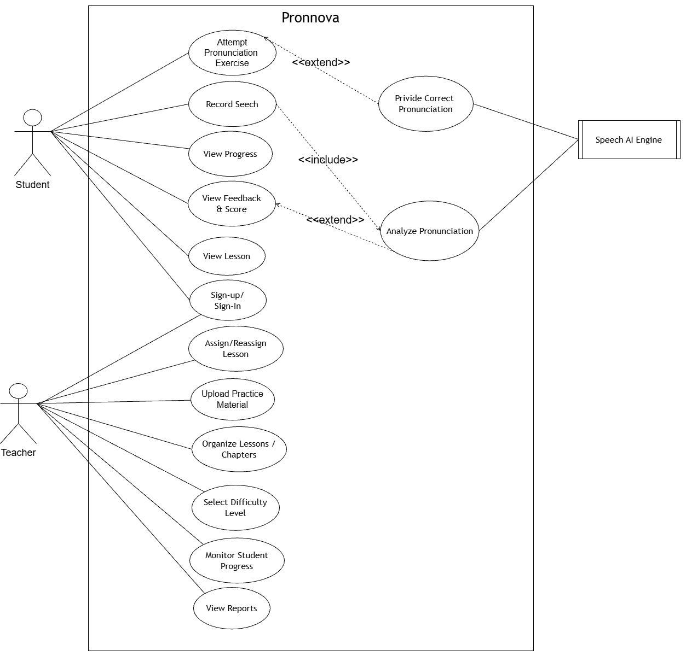

*Figure 1: Use Case Diagram*

### 4.2 High Level Use Cases

#### 4.2.1 UC-01: Sign-Up

*Table 7: Sign-Up*

| Field | Value |
|---|---|
| **Use case ID** | UC-01 |
| **Use case Name** | Sign-Up |
| **Actor** | Student, Teacher |
| **Type** | Primary |
| **Description** | The user creates an account with a role (Student or Teacher) to access the system. |

#### 4.2.2 UC-02: Sign-In

*Table 8: Sign-In*

| Field | Value |
|---|---|
| **Use case ID** | UC-02 |
| **Use case Name** | Sign-In |
| **Actor** | Student, Teacher |
| **Type** | Primary |
| **Description** | The user logs in securely and receives role-based access. |

#### 4.2.3 UC-03: View Lesson

*Table 9: View Lesson*

| Field | Value |
|---|---|
| **Use case ID** | UC-03 |
| **Use case Name** | View Lesson |
| **Actor** | Student |
| **Type** | Primary |
| **Description** | The Student opens a Chapter and Level, views the Words, Short phrases, Sentences or Paragraphs to practice and resumes from the previous stage. |

#### 4.2.4 UC-04: Attempt Pronunciation Exercise

*Table 10: Attempt Pronunciation Exercise*

| Field | Value |
|---|---|
| **Use case ID** | UC-04 |
| **Use case Name** | Attempt Pronunciation Exercise |
| **Actor** | Student, Speech Engine |
| **Type** | Primary |
| **Description** | The student starts an Exercise and reads the displayed text aloud. The system processes the speech, compares it with the expected text and scores it at word and sound level and shows the result. The use case includes Record Speech and View Feedback & Score. |

#### 4.2.5 UC-05: Record Speech

*Table 11: Record Speech*

| Field | Value |
|---|---|
| **Use case ID** | UC-05 |
| **Use case Name** | Record Speech |
| **Actor** | Student, Speech Engine |
| **Type** | Primary |
| **Description** | The student reads the displayed text aloud and the system captures the speech through the microphone. It is included by UC-04. |

#### 4.2.6 UC-06: View Feedback & Score

*Table 12: View Feedback & Score*

| Field | Value |
|---|---|
| **Use case ID** | UC-06 |
| **Use case Name** | View Feedback & Score |
| **Actor** | Student |
| **Type** | Primary |
| **Description** | The Student receives immediate Feedback, the incorrect words and sounds, a percentage Pronunciation Score and a classification (Excellent, Good or Average) after every Attempt. It is included by UC-04. |

#### 4.2.7 UC-07: View Progress

*Table 13: View Progress*

| Field | Value |
|---|---|
| **Use case ID** | UC-07 |
| **Use case Name** | View Progress |
| **Actor** | Student, AI Engine |
| **Type** | Primary |
| **Description** | The Student views progress over time, the repeatedly mispronounced words and sounds with Attempts, Errors and Error Rate, and receives personalized suggestions and extra practice generated with the Gemini API. |

#### 4.2.8 UC-08: Assign / Reassign Lesson

*Table 14: Assign / Reassign Lesson*

| Field | Value |
|---|---|
| **Use case ID** | UC-08 |
| **Use case Name** | Assign / Reassign Lesson |
| **Actor** | Teacher |
| **Type** | Secondary |
| **Description** | The Teacher assigns a lesson or homework to a Student or a class and can reassign it to another Student or class. |

#### 4.2.9 UC-09: Select Difficulty Level

*Table 15: Select Difficulty Level*

| Field | Value |
|---|---|
| **Use case ID** | UC-09 |
| **Use case Name** | Select Difficulty Level |
| **Actor** | Teacher |
| **Type** | Secondary |
| **Description** | The Teacher sets the difficulty level (Basic, Medium or Advanced) of an assigned lesson or Exercise. |

#### 4.2.10 UC-10: Upload Practice Material

*Table 16: Upload Practice Material*

| Field | Value |
|---|---|
| **Use case ID** | UC-10 |
| **Use case Name** | Upload Practice Material |
| **Actor** | Teacher |
| **Type** | Secondary |
| **Description** | The Teacher uploads practice material or homework for Students. |

#### 4.2.11 UC-11: Organize Lessons / Chapters

*Table 17: Organize Lessons / Chapters*

| Field | Value |
|---|---|
| **Use case ID** | UC-11 |
| **Use case Name** | Organize Lessons / Chapters |
| **Actor** | Teacher |
| **Type** | Secondary |
| **Description** | The Teacher arranges lessons into sequential Chapters. |

#### 4.2.12 UC-12: Monitor Student Progress

*Table 18: Monitor Student Progress*

| Field | Value |
|---|---|
| **Use case ID** | UC-12 |
| **Use case Name** | Monitor Student Progress |
| **Actor** | Teacher |
| **Type** | Secondary |
| **Description** | The Teacher views individual and class-wide pronunciation progress and evaluates the completed Attempts of Students. |

#### 4.2.13 UC-13: View Reports

*Table 19: View Reports*

| Field | Value |
|---|---|
| **Use case ID** | UC-13 |
| **Use case Name** | View Reports |
| **Actor** | Teacher |
| **Type** | Secondary |
| **Description** | The Teacher views progress reports for a Student or the class. |

### 4.3 Expanded Use Cases

#### 4.3.1 UC-01: Sign-Up

*Table 20: Sign-Up*

| Field | Value |
|---|---|
| **Use case ID** | UC-01 |
| **Use case Name** | Sign-Up |
| **Created by** | Muhammad Fahad |
| **Last updated by** | Muhammad Fahad |
| **Date Created** | 03/10/2026 |
| **Revision Date** | 03/10/2026 |
| **Actor** | Student, Teacher |
| **Description** | The user creates an account with a role (Student or Teacher) to access the system. |
| **Trigger** | The user selects “Sign Up”. |
| **Pre-condition** | The user has internet access and an unregistered email. |
| **Post-condition** | • Account is created with the selected role. • The user is signed in. |
| **Normal flow** | 1. The user enters name, email and password. 2. The user selects the role (Student or Teacher). 3. The system validates the data and checks that the email is not registered. 4. The system stores the account with a hashed password. 5. The system opens the Student home page or the Teacher dashboard. |
| **Alternative flow** | 1A: A Student enters the class code of a Teacher’s class to join it. 3A: If the email is registered, the system offers the Sign-In page. |
| **Exceptions** | • Invalid data. • Email already registered. • Network failure. |
| **Includes** | N/A. |
| **Extends** | N/A. |
| **Frequency of use** | Low, used once per user. |
| **Special Requirements** | • Password hashing • Internet connectivity |

#### 4.3.2 UC-02: Sign-In

*Table 21: Sign-In*

| Field | Value |
|---|---|
| **Use case ID** | UC-02 |
| **Use case Name** | Sign-In |
| **Created by** | Muhammad Usman |
| **Last updated by** | Muhammad Usman |
| **Date Created** | 03/10/2026 |
| **Revision Date** | 03/10/2026 |
| **Actor** | Student, Teacher |
| **Description** | The user logs in securely and receives role-based access. |
| **Trigger** | The user selects “Sign In”. |
| **Pre-condition** | The user has a registered account. |
| **Post-condition** | • The user is authenticated. • A session starts with the access rights of the role. |
| **Normal flow** | 1. The user enters email and password. 2. The system validates the credentials. 3. The system identifies the role of the user. 4. The system opens the Student home page or the Teacher dashboard. |
| **Alternative flow** | 2A: A user without an account is directed to Sign-Up. |
| **Exceptions** | • Invalid credentials. • Network failure. |
| **Includes** | N/A. |
| **Extends** | N/A. |
| **Frequency of use** | High, used each time a user signs in. |
| **Special Requirements** | • Role-based access control • Password hashing • Internet connectivity |

#### 4.3.3 UC-03: View Lesson

*Table 22: View Lesson*

| Field | Value |
|---|---|
| **Use case ID** | UC-03 |
| **Use case Name** | View Lesson |
| **Created by** | Muteeba Shahzad |
| **Last updated by** | Muteeba Shahzad |
| **Date Created** | 03/10/2026 |
| **Revision Date** | 03/10/2026 |
| **Actor** | Student |
| **Description** | The Student opens a Chapter and Level, views the Words, Short phrases, Sentences or Paragraphs to practice and resumes from the previous stage. |
| **Trigger** | The Student opens the Learn page. |
| **Pre-condition** | The Student is signed in. |
| **Post-condition** | • A lesson is displayed. • The Student’s stage is saved. |
| **Normal flow** | 1. The system displays the Chapters in sequence with the Student’s stage. 2. The Student selects a Chapter. 3. The system displays its Basic, Medium and Advanced Levels. 4. The Student selects an unlocked Level. 5. The system displays the Words, Short phrases, Sentences or Paragraphs of the Level. 6. The Student selects an Exercise to practice. |
| **Alternative flow** | 1A: The Student selects Continue and the system opens the previous stage. 1B: The Student opens assigned homework and views its Exercises. |
| **Exceptions** | • Level is locked. • No Exercises in the Level. • Network failure. |
| **Includes** | N/A. |
| **Extends** | N/A. |
| **Frequency of use** | High, used at the start of each practice session. |
| **Special Requirements** | • Progress saved per Student • Internet connectivity |

#### 4.3.4 UC-04: Attempt Pronunciation Exercise

*Table 23: Attempt Pronunciation Exercise*

| Field | Value |
|---|---|
| **Use case ID** | UC-04 |
| **Use case Name** | Attempt Pronunciation Exercise |
| **Created by** | Muhammad Fahad |
| **Last updated by** | Muhammad Usman |
| **Date Created** | 03/10/2026 |
| **Revision Date** | 03/10/2026 |
| **Actor** | Student, Speech Engine |
| **Description** | The Student starts an Exercise and reads the displayed text aloud. The system transcribes the speech, aligns it with the expected text, scores it at word and phoneme level and shows the result. The use case includes Record Speech and View Feedback & Score. |
| **Trigger** | The Student selects “Start Practice” on an Exercise. |
| **Pre-condition** | The Student is signed in and has selected an Exercise. |
| **Post-condition** | • The Attempt, word results and Pronunciation Score are stored. • Error statistics and progress are updated. |
| **Normal flow** | 1. The system displays the reference text of the Exercise. 2. The student reads the text aloud and the system records the speech (UC-05). 3. The Speech AI Engine processes the speech and compares it with the reference text. 4. The Speech AI Engine scores the speech and detects incorrectly pronounced words and problematic sounds. 5. The system calculates the word scores, the Pronunciation Score and the classification, stores the Attempt and updates error statistics and progress. 6. The system displays Feedback, Pronunciation Score and classification (UC-06). |
| **Alternative flow** | 2A: The Student cancels the recording and no Attempt is stored. 6A: The Student retries the Exercise. |
| **Exceptions** | Microphone not available. Speech processing failure Network failure. |
| **Includes** | UC-05 Record Speech; UC-06 View Feedback & Score. |
| **Extends** | N/A. |
| **Frequency of use** | Very high, the core activity of the system. |
| **Special Requirements** | • Microphone access • Speech Engine • Internet connectivity |

#### 4.3.5 UC-05: Record Speech

*Table 24: Record Speech*

| Field | Value |
|---|---|
| **Use case ID** | UC-05 |
| **Use case Name** | Record Speech |
| **Created by** | Muhammad Usman |
| **Last updated by** | Muteeba Shahzad |
| **Date Created** | 03/10/2026 |
| **Revision Date** | 03/10/2026 |
| **Actor** | Student, Speech Engine |
| **Description** | The Student reads the displayed text aloud and the system captures the speech through the microphone. It is included by UC-04. |
| **Trigger** | The Student selects “Record” during an Attempt. |
| **Pre-condition** | The Student has started an Exercise and has allowed microphone access. |
| **Post-condition** | • The audio recording of the Student’s reading is captured. • The recording is sent to the Speech Engine. |
| **Normal flow** | 1. The Student selects Record. 2. The system captures the speech through the microphone. 3. The Student stops the recording. 4. The system sends the recording to the Speech Engine. |
| **Alternative flow** | 3A: The Student cancels the recording and the audio is discarded. |
| **Exceptions** | • Microphone not available. • Microphone permission denied. • Network failure. |
| **Includes** | N/A. |
| **Extends** | N/A. |
| **Frequency of use** | Very high, used in every Attempt. |
| **Special Requirements** | • Microphone access • Internet connectivity |

#### 4.3.6 UC-06: View Feedback & Score

*Table 25: View Feedback & Score*

| Field | Value |
|---|---|
| **Use case ID** | UC-06 |
| **Use case Name** | View Feedback & Score |
| **Created by** | Muteeba Shahzad |
| **Last updated by** | Muhammad Fahad |
| **Date Created** | 03/10/2026 |
| **Revision Date** | 03/10/2026 |
| **Actor** | Student |
| **Description** | The Student receives immediate Feedback, the incorrect words and sounds, a percentage Pronunciation Score and a classification (Excellent, Good or Average) after every Attempt. It is included by UC-04. |
| **Trigger** | The system completes the scoring of an Attempt. |
| **Pre-condition** | The Attempt has been recorded and scored. |
| **Post-condition** | • The Student has seen the Feedback and the Pronunciation Score. |
| **Normal flow** | 1. The system displays the Pronunciation Score as a percentage. 2. The system displays the classification (Excellent, Good or Average). 3. The system displays the incorrect words and sounds with Feedback on each. 4. The Student reviews the result. |
| **Alternative flow** | 4A: The Student retries the Exercise. 4B: The Student moves to the next Exercise. |
| **Exceptions** | • Scoring result not available. • Network failure. |
| **Includes** | N/A. |
| **Extends** | N/A. |
| **Frequency of use** | Very high, used after every Attempt. |
| **Special Requirements** | • Immediate display of the result • Internet connectivity |

#### 4.3.7 UC-07: View Progress

*Table 26: View Progress*

| Field | Value |
|---|---|
| **Use case ID** | UC-07 |
| **Use case Name** | View Progress |
| **Created by** | Muhammad Usman |
| **Last updated by** | Muteeba Shahzad |
| **Date Created** | 03/10/2026 |
| **Revision Date** | 03/10/2026 |
| **Actor** | Student, AI Engine |
| **Description** | The Student views progress over time, the repeatedly mispronounced words and sounds with Attempts, Errors and Error Rate, and receives personalized suggestions and extra practice generated with an external AI API service. |
| **Trigger** | The Student selects “Progress”. |
| **Pre-condition** | The Student is signed in and has completed at least one Attempt. |
| **Post-condition** | • The Student has seen the progress and the repeated errors. • A Recommendation is stored. |
| **Normal flow** | 1. The system displays the Student’s progress over time. 2. The system displays the repeatedly mispronounced words and sounds with Attempts, Errors and Error Rate. 3. The system sends the weak areas to the AI Engine. 4. The AI Engine returns personalized suggestions and extra practice. 5. The system stores and displays the suggestions and extra practice. |
| **Alternative flow** | 1A: The Student has no Attempts and the system asks the Student to complete an Exercise first. 3A: The AI Engine is unavailable and the system displays the progress without suggestions. |
| **Exceptions** | • AI Engine unavailable. • Network failure. |
| **Includes** | N/A. |
| **Extends** | N/A. |
| **Frequency of use** | Medium, used after practice sessions. |
| **Special Requirements** | • Gemini API access • Internet connectivity |

#### 4.3.8 UC-08: Assign / Reassign Lesson

*Table 27: Assign / Reassign Lesson*

| Field | Value |
|---|---|
| **Use case ID** | UC-08 |
| **Use case Name** | Assign / Reassign Lesson |
| **Created by** | Muteeba Shahzad |
| **Last updated by** | Muhammad Fahad |
| **Date Created** | 03/10/2026 |
| **Revision Date** | 03/10/2026 |
| **Actor** | Teacher |
| **Description** | The Teacher assigns a lesson or homework to a Student or a class and can reassign it to another Student or class. |
| **Trigger** | The Teacher selects “Assign Lesson” on the dashboard. |
| **Pre-condition** | The Teacher is signed in and has at least one class or Student. |
| **Post-condition** | • The lesson or homework is assigned to the selected Student or class. |
| **Normal flow** | 1. The Teacher selects a lesson or homework. 2. The Teacher selects a Student or a class. 3. The Teacher sets the due date. 4. The system stores the assignment and makes it available to the Student or class. |
| **Alternative flow** | 1A: The Teacher selects an assigned lesson and reassigns it to another Student or class. |
| **Exceptions** | • No Student or class selected. • Network failure. |
| **Includes** | N/A. |
| **Extends** | N/A. |
| **Frequency of use** | Medium, used when lessons or homework are assigned. |
| **Special Requirements** | • Role-based access control • Internet connectivity |

#### 4.3.9 UC-09: Select Difficulty Level

*Table 28: Select Difficulty Level*

| Field | Value |
|---|---|
| **Use case ID** | UC-09 |
| **Use case Name** | Select Difficulty Level |
| **Created by** | Muhammad Fahad |
| **Last updated by** | Muhammad Usman |
| **Date Created** | 03/10/2026 |
| **Revision Date** | 03/10/2026 |
| **Actor** | Teacher |
| **Description** | The Teacher sets the difficulty level (Basic, Medium or Advanced) of an assigned lesson or Exercise. |
| **Trigger** | The Teacher selects “Set Level” on an assigned lesson or Exercise. |
| **Pre-condition** | The Teacher is signed in and has assigned a lesson or Exercise. |
| **Post-condition** | • The difficulty level of the lesson or Exercise is saved. |
| **Normal flow** | 1. The Teacher opens an assigned lesson or Exercise. 2. The Teacher selects Basic, Medium or Advanced. 3. The system saves the difficulty level. |
| **Alternative flow** | 2A: The Teacher changes the level of an assigned lesson that has already been set. |
| **Exceptions** | • No lesson or Exercise selected. • Network failure. |
| **Includes** | N/A. |
| **Extends** | N/A. |
| **Frequency of use** | Medium, used when lessons are assigned. |
| **Special Requirements** | • Role-based access control • Internet connectivity |

#### 4.3.10 UC-10: Upload Practice Material

*Table 29: Upload Practice Material*

| Field | Value |
|---|---|
| **Use case ID** | UC-10 |
| **Use case Name** | Upload Practice Material |
| **Created by** | Muhammad Fahad |
| **Last updated by** | Muteeba Shahzad |
| **Date Created** | 03/10/2026 |
| **Revision Date** | 03/10/2026 |
| **Actor** | Teacher |
| **Description** | The Teacher uploads practice material or homework for Students. |
| **Trigger** | The Teacher selects “Upload Material”. |
| **Pre-condition** | The Teacher is signed in. |
| **Post-condition** | • The practice material or homework is stored and available to Students. |
| **Normal flow** | 1. The Teacher enters the title, instructions and due date. 2. The Teacher adds the words, phrases, sentences or paragraphs to practice. 3. The Teacher selects the class that receives the material. 4. The system stores the material and makes it available to the Students. |
| **Alternative flow** | 3A: The Teacher saves the material without selecting a class and assigns it later. |
| **Exceptions** | • Required field is empty. • Network failure. |
| **Includes** | N/A. |
| **Extends** | N/A. |
| **Frequency of use** | Medium, used when homework is assigned. |
| **Special Requirements** | • Role-based access control • Internet connectivity |

#### 4.3.11 UC-11: Organize Lessons / Chapters

*Table 30: Organize Lessons / Chapters*

| Field | Value |
|---|---|
| **Use case ID** | UC-11 |
| **Use case Name** | Organize Lessons / Chapters |
| **Created by** | Muteeba Shahzad |
| **Last updated by** | Muhammad Usman |
| **Date Created** | 03/10/2026 |
| **Revision Date** | 03/10/2026 |
| **Actor** | Teacher |
| **Description** | The Teacher arranges lessons into sequential Chapters. |
| **Trigger** | The Teacher selects “Organize Chapters”. |
| **Pre-condition** | The Teacher is signed in and lessons exist. |
| **Post-condition** | • The lessons are arranged in sequential Chapters. |
| **Normal flow** | 1. The system displays the Chapters and their lessons. 2. The Teacher moves a lesson into a Chapter or changes its position. 3. The Teacher saves the arrangement. 4. The system stores the new sequence of the Chapters and lessons. |
| **Alternative flow** | 2A: The Teacher creates a new Chapter and adds lessons to it. |
| **Exceptions** | • Chapter sequence is invalid. • Network failure. |
| **Includes** | N/A. |
| **Extends** | N/A. |
| **Frequency of use** | Low, used when the course content changes. |
| **Special Requirements** | • Role-based access control • Internet connectivity |

#### 4.3.12 UC-12: Monitor Student Progress

*Table 31: Monitor Student Progress*

| Field | Value |
|---|---|
| **Use case ID** | UC-12 |
| **Use case Name** | Monitor Student Progress |
| **Created by** | Muhammad Fahad |
| **Last updated by** | Muhammad Usman |
| **Date Created** | 03/10/2026 |
| **Revision Date** | 03/10/2026 |
| **Actor** | Teacher |
| **Description** | The Teacher views individual and class-wide pronunciation progress and evaluates the completed Attempts of Students. |
| **Trigger** | The Teacher opens the dashboard. |
| **Pre-condition** | The Teacher is signed in and has Students in a class. |
| **Post-condition** | • The Teacher has seen the progress of the Student or class. • An evaluation is stored if the Teacher evaluated an Attempt. |
| **Normal flow** | 1. The system displays the class-wide pronunciation progress. 2. The Teacher selects a Student. 3. The system displays the Attempts, Pronunciation Scores and progress of the Student. 4. The Teacher evaluates a completed Attempt with a rating and a comment. 5. The system stores the evaluation. |
| **Alternative flow** | 2A: The Teacher stays on the class view and does not select a Student. |
| **Exceptions** | • No Attempts available. • Network failure. |
| **Includes** | N/A. |
| **Extends** | N/A. |
| **Frequency of use** | High, used regularly by Teachers. |
| **Special Requirements** | • Role-based access control • Internet connectivity |

#### 4.3.13 UC-13: View Reports

*Table 32: View Reports*

| Field | Value |
|---|---|
| **Use case ID** | UC-13 |
| **Use case Name** | View Reports |
| **Created by** | Muhammad Usman |
| **Last updated by** | Muhammad Fahad |
| **Date Created** | 03/10/2026 |
| **Revision Date** | 03/10/2026 |
| **Actor** | Teacher |
| **Description** | The Teacher views progress reports for a Student or the class. |
| **Trigger** | The Teacher selects “Reports”. |
| **Pre-condition** | The Teacher is signed in and the Student or class has completed Attempts. |
| **Post-condition** | • The report of the Student or class is displayed. |
| **Normal flow** | 1. The Teacher selects a Student or the class. 2. The system compiles the Pronunciation Scores and progress of the selection. 3. The system displays the progress report. |
| **Alternative flow** | 1A: The Teacher selects a different Student or the class to view another report. |
| **Exceptions** | • No Attempts available. • Network failure. |
| **Includes** | N/A. |
| **Extends** | N/A. |
| **Frequency of use** | Medium, used periodically by Teachers. |
| **Special Requirements** | • Role-based access control • Internet connectivity |

### 4.4 Activity Diagram (Swim Lane)

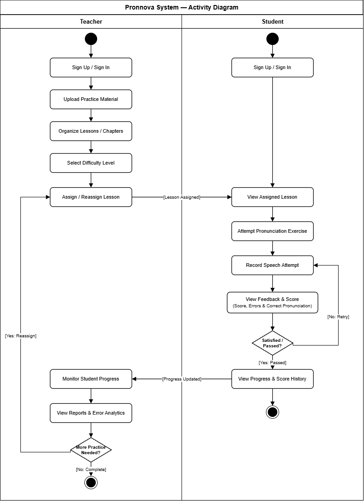

*Figure 2: Activity Diagram*

### 4.5 System Sequence Diagrams

#### 4.5.1 Sign-Up

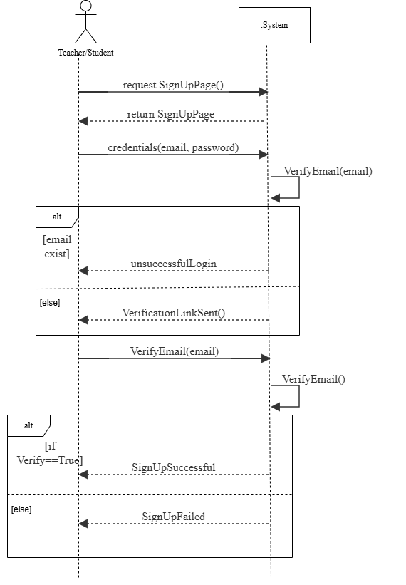

*Figure 3: SSD For Sign-Up*

#### 4.5.2 Sign-In

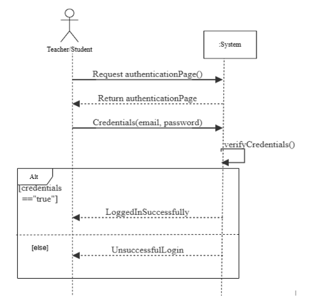

*Figure 4: SSD For Sign-In*

#### 4.5.3 View Lesson

*Figure 5: SSD For View Lesson*

#### 4.5.4 Attempt Pronunciation Exercise

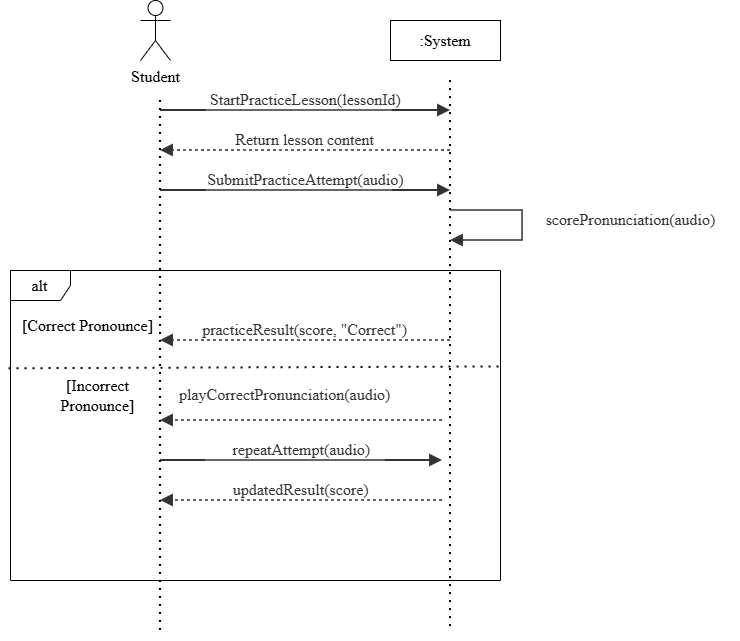

*Figure 6: SSD For Attempt Pronunciation Exercise*

#### 4.5.5 Record Speech

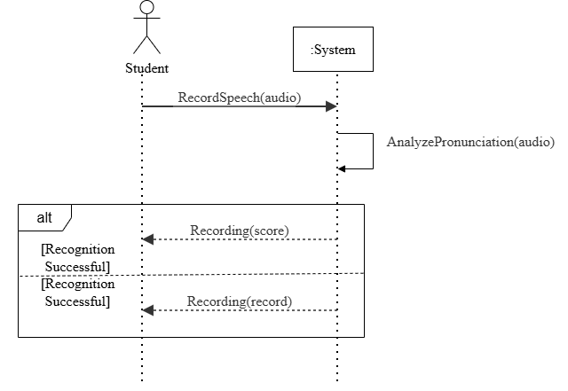

*Figure 7: SSD For Record Speech*

#### 4.5.6 View Feedback & Score

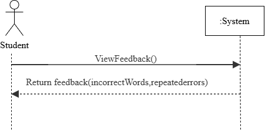

*Figure 8: SSD For View Feedback & Score*

#### 4.5.7 View Progress

*Figure 9: SSD For View Progress*

#### 4.5.8 Assign / Reassign Lesson

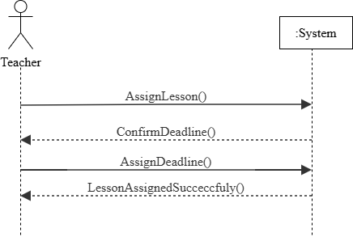

*Figure 10: SSD For Assign / Reassign Lesson*

#### 4.5.9 Select Difficulty Level

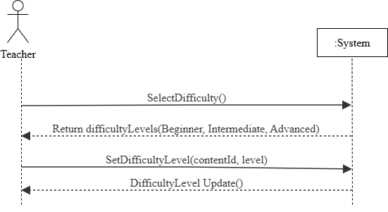

*Figure 11: SSD For Select Difficulty Level*

#### 4.5.10 Upload Practice Material

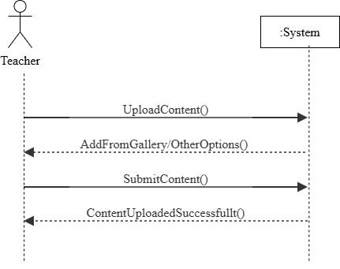

*Figure 12: SSD For Upload Practice Material*

#### 4.5.11 Organize Lessons / Chapters

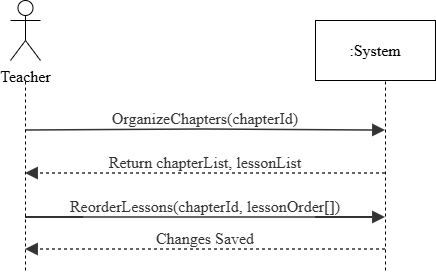

*Figure 13: SSD For Organize Lessons / Chapters*

#### 4.5.12 Monitor Student Progress

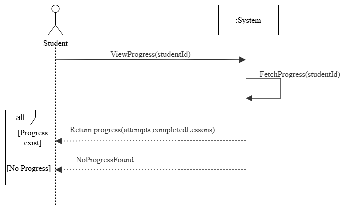

*Figure 14: SSD For Monitor Student Progress*

#### 4.5.13 View Reports

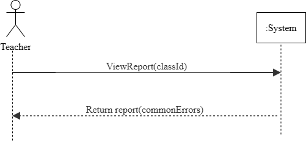

*Figure 15: SSD For View Reports*

### 4.6 Data Flow Diagrams

#### 4.6.1 Data Flow Diagram: Level 0

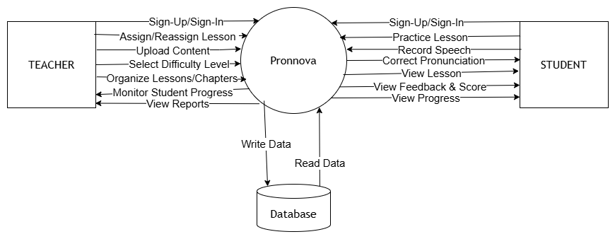

*Figure 16: DFD Level 0*

#### 4.6.2 Data Flow Diagram: Level 1

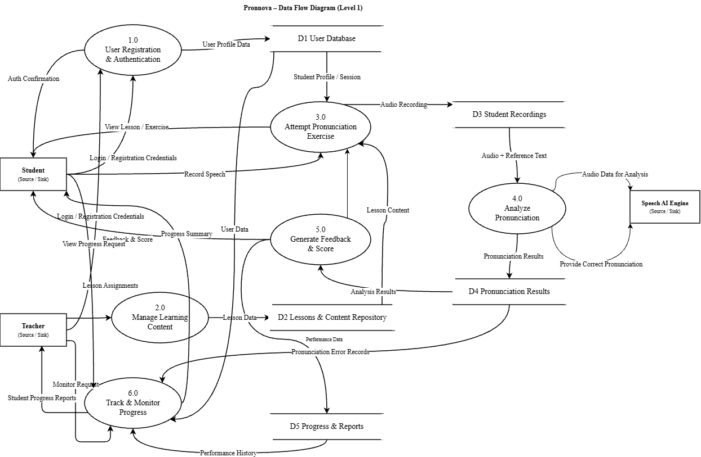

*Figure 17: DFD Level 1*

#### 4.6.3 Data Flow Diagram: Level 2

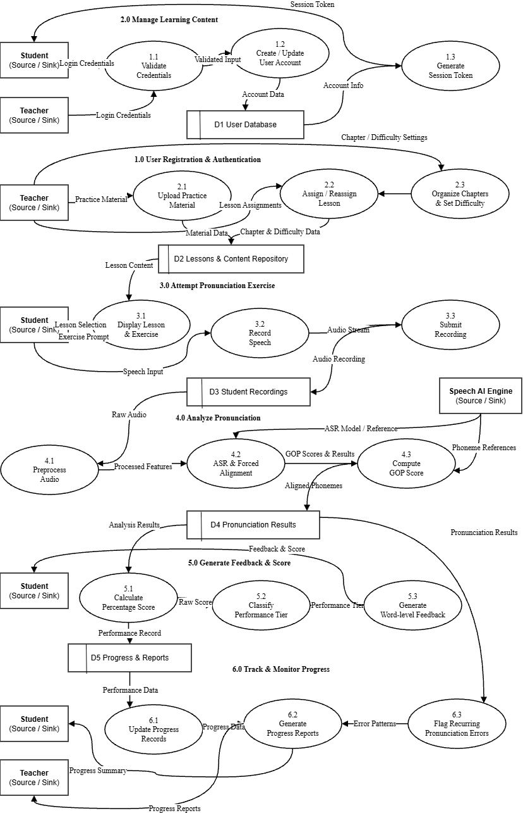

*Figure 18: DFD Level 2*

### 4.7 Component Diagram

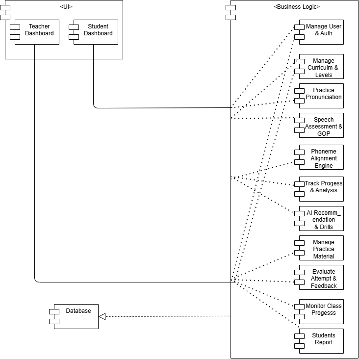

*Figure 19: Component Diagram*

### 4.8 Package Diagram

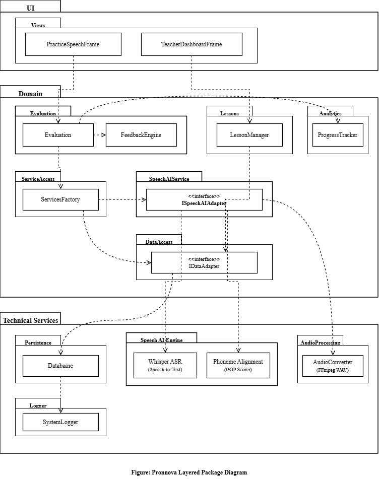

*Figure 20: Package Diagram*

### 4.9 ER Diagram

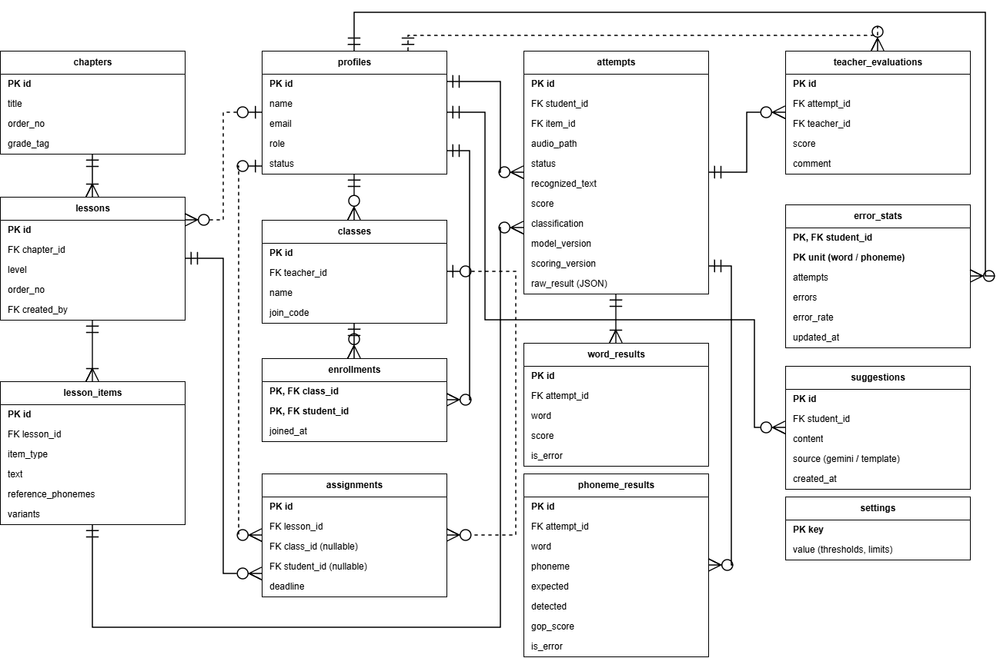

*Figure 21: ER Diagram*
